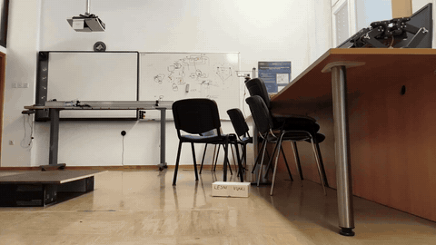
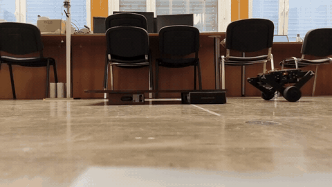
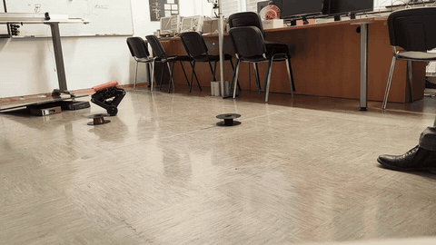
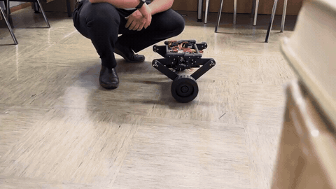

# Embedded Recurrent Balance Control

Code accompanying the paper

> J. Tofant, D. Gleich and A. Sarjaš, *Robust Stabilization of a Reconfigurable Wheeled
> Bipedal Robot Using a GRU-Based Reinforcement Learning Policy on a Microcontroller*.

<table>
  <tr>
    <td align="center" width="50%"><a href="media/table-jump.mp4"></a><br><sub><b>Driving off a table and landing</b><br><i>The torso acts as a damper, absorbing the landing.</i></sub></td>
    <td align="center" width="50%"><a href="media/platform-jump.mp4"></a><br><sub><b>Jumping onto a platform</b><br><i>The torso generates the jump acceleration.</i></sub></td>
  </tr>
  <tr>
    <td align="center" width="50%"><a href="media/book-maneuvering.mp4"></a><br><sub><b>Manoeuvring with a book on top</b><br><i>The torso stays stiff to carry the book.</i></sub></td>
    <td align="center" width="50%"><a href="media/wheel-swap.mp4"></a><br><sub><b>Swapping to a different wheel diameter while balancing</b><br><i>The policy keeps balancing on mismatched wheels, with no retuning.</i></sub></td>
  </tr>
</table>

This repository contains the STM32 firmware and the trained GRU policy that produced the
paper's hardware results. They are published as they ran on the robot,
without later changes.

| Path | Contents |
|---|---|
| `firmware/` | STM32CubeIDE project for the STM32F446RE (HAL, X-CUBE-AI 8.1.0 runtime, generated networks) |
| `models/` | The deployed GRU policy as ONNX, its TorchScript checkpoint, checksums and a validation script |
| `media/` | Hardware demonstration clips shown above (GIF previews, MP4 originals) |
| `tools/` | GRU graph expansion for X-CUBE-AI and the UART telemetry capture used during the experiments |

## Policy

The GRU is a range-randomized drive policy trained in Isaac Lab with PPO. It maps
13 normalized observations to two wheel current commands in amperes, limited to ±2 A by an
output `2·tanh(·)`.

| File | Policy | Architecture | Parameters | Firmware network | `ACTIVE_NN_POLICY` |
|---|---|---|---|---|---|
| `GRU_range_C_stm32ai.onnx` | GRU (C) | GRU, 64 hidden units | 23,618 | `nn_arm_c_range_gru` | `POLICY_RANGE_GRU` (2) |

`GRU_range_C_native.onnx` is the GRU as exported from PyTorch. X-CUBE-AI 8.1 cannot import
an ONNX GRU node that exposes its hidden state, so `tools/expand_gru_for_stm32ai.py`
rewrites it into elementary operations (`GRU_range_C_stm32ai.onnx`). That expanded graph is
the one compiled into the firmware; the native graph is kept as the equivalence reference.
The ONNX files are byte-identical to those used to generate the firmware networks
(`SHA256SUMS.txt`).

To check the models on a CPU (needs `numpy`, `onnx`, `onnxruntime`, `torch`):

```bash
cd models
python validate_models.py
```

It replays 1024 random observations and requires every ONNX graph to match its TorchScript
reference, and the expanded GRU to match the native one, to within 1e-4 A.

### Interface

The policy runs on the 15 ms (66.7 Hz) TIM4 control tick. Inputs are scaled as below and
clipped to ±10 (`firmware/Core/Src/main.c`, `ANN_Run`):

| Index | Quantity | Scaling |
|---|---|---|
| 0 | position error from wheel odometry | / 0.5 m |
| 1 | forward velocity | / 1.0 m/s |
| 2 | pitch | / 25° |
| 3 | pitch rate | / 4 rad/s |
| 4, 5 | sin, cos of heading error | — |
| 6 | yaw rate | / 4 rad/s |
| 7 | commanded forward velocity | / 1.0 m/s |
| 8 | commanded yaw rate | / 2 rad/s |
| 9, 10 | previous left, right wheel current command | / 2 A |
| 11 | roll | / 25° |
| 12 | roll rate | / 4 rad/s |

Outputs (`current_a`) are left and right wheel currents in amperes. The GRU additionally
takes `h_in` and returns `h_out` (64 values); the firmware zeroes the hidden state at start-up
and after an invalid inference, and otherwise carries `h_out` forward every tick.

## Firmware

Hardware: STM32F446RE, BNO08x IMU on I2C3, two DDSM115 hub motors on RS485 (wheels) and four
Xiaomi CyberGear actuators on CAN (legs, position-held at kp = 30, kd = 3).

1. Open `firmware/` as an existing project in STM32CubeIDE.
2. Build and flash. The network C sources under `firmware/X-CUBE-AI/App/` are already
   generated; regenerating them is only needed if a model changes.

`firmware/Docs/PAPER_TELEMETRY.md` describes the telemetry stream recorded during the
hardware experiments, which `tools/paper_uart_capture.py` captures to CSV.

## Licence

The code and models written for this work are released under the MIT licence (`LICENSE`).
Vendor components keep their own licences: the STM32 HAL and CMSIS under `firmware/Drivers/`
and the X-CUBE-AI runtime under `firmware/Middlewares/ST/AI/` and `firmware/X-CUBE-AI/`
(see the `LICENSE.txt` files in those directories).

## Acknowledgment

This work was supported by the Slovenian Research and Innovation Agency (ARIS) and the
University of Maribor under the research programme Telematics (P2-0065).
